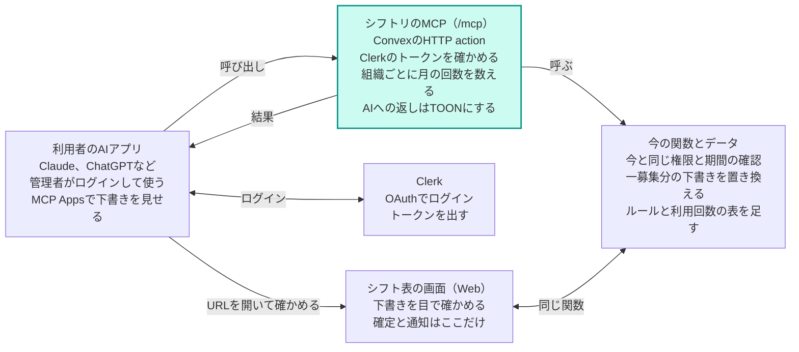
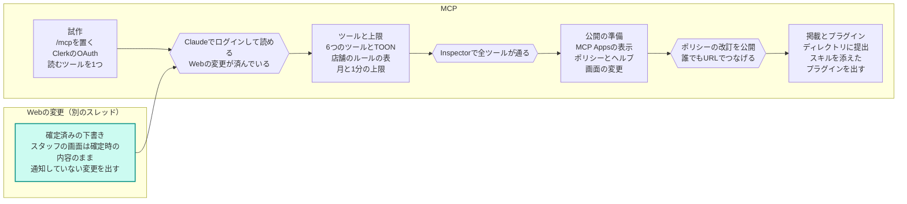

# シフトリのMCP機能 実装計画

> 状態: Proposed（v2.0.0では実装を見送る。2026-11-28に決定）
>
> 作成日: 2026-11-27
>
> 更新日: 2026-11-28（画面の案の2、4、5と、未決の問いの一部を決めた）
>
> 元の文書: Claude Docの「シフトリのMCP機能 実装計画」を書き出した。画面の案はDesignのキャンバス「シフトリ MCP機能の画面の案」にある（どちらも非公開）。

管理者が自分のAI(ClaudeやChatGPTなど)から、シフトの下書きを読み、直し、保存できるMCPサーバーを作ります。AIからは確定も通知もせず、最後はシフト表の画面で目で確かめてもらいます。先にWebで確定済みの募集にも本当の下書きを作り、その上にMCPを載せます。

## 目的と範囲

画面を開かなくても、AIとの会話でシフトの下書きを直せるようにします。使えるのは管理者だけで、全プランが対象です。

**やること**

- AIから、組織、店舗、募集、希望、下書き、店舗のルールを読む。
- AIが直した下書きを、一募集分まとめて保存する。提出期限前の募集中と、確定済みの募集も対象にする。
- 店舗ごとのルール(自由な文章)を、AIから読み、上書きで保存する。
- 保存したあとにシフト表の画面のURLを返し、目で確かめてもらう。
- 組織ごとに、月の呼び出し回数に上限を置く。

**やらないこと**

- AIからの確定、再送、募集の作成と編集。スタッフに通知が飛ぶためです。
- スタッフからの利用。スタッフはアカウントを持たず、メールやLINEのリンクで提出しています(`doc/features/OVERVIEW.md`)。
- 人件費と労務の判断。AIに渡すのは勤務、希望、メモ、設定、ルールだけです。休憩は自動作成と同じ入れ方を初期値として渡し、法律に合うかは判断しません。
- 自前のトークンの発行。ログインはClerkのOAuthを使います。Claudeにはキーを貼ってつなぐ方式もありますが、ベータで、組織のオーナーが入れた1つのキーを呼び出しのたびに送る形です([Claudeの認証の説明](https://claude.com/docs/connectors/building/authentication))。管理者ごとのログインにならないので使いません。

## 全体の構成

**AIの読み書きは今の関数を通し、確定と通知はWebだけに残す**

色の付いた枠が新しく作る入口です。確定と通知のツールは作りません。

AIのアプリが呼ぶのはシフトリの `/mcp` だけです。`/mcp` はトークンを確かめて回数を数え、今の関数で読み書きして、結果をTOONで返します。確定と通知のツールは作らず、シフト表の画面だけに残します。

- `convex/http.ts` に、`/mcp` と保護リソースのメタデータのルートを足します。
- ツールの中身は `convex/mcp/` にまとめ、読み書きは内部の関数から今の処理を呼びます。権限の確かめ方は「ログインと権限」に書きました。
- 接続先のURLは、あとで変えると利用者がつなぎ直すことになります。公開の前に、Convexの既定のURLのままにするか、シフトリのドメインにするかを決めます。

## ツールの一覧

ツールは読む4つと書く2つに分け、全部に名前と印を付けます。Claudeのディレクトリは、読み書きの分離と印を掲載の条件にしています([審査の基準](https://claude.com/docs/connectors/building/review-criteria))。

| ツール | 印 | すること |
| --- | --- | --- |
| `list_shops` | 読むだけ | 管理している組織と店舗を返す |
| `list_recruitments` | 読むだけ | 店舗の募集を返す。期間、提出期限、状態(募集中、要調整、確定済み)、下書き保存の時刻 |
| `get_shift_draft` | 読むだけ | 1つの募集の、スタッフ、希望と出した時刻、メモ、今の下書き、必要人数、ポジション、休憩の入れ方、定休日、店舗のルール、`draftSavedAt` をTOONで返す |
| `save_shift_draft` | 書き換える | 一募集分の勤務をまとめて置き換える。確定も通知もしない。保存したらシフト表のURLを返す |
| `get_shop_rules` | 読むだけ | 店舗のルールの文章を返す |
| `save_shop_rules` | 書き換える | 店舗のルールを上書きで保存する。2,000字まで |

- 「読むだけ」は `readOnlyHint: true`、「書き換える」は `destructiveHint: true` です。Claudeは書き換えるツールを呼ぶ前に、利用者へ確かめることがあります(同じページ)。
- `save_shift_draft` は読んだときの `draftSavedAt` を受け取り、今の値と違えば保存せずに理由を返します。AIの作業中に画面で保存した分を消さないためです。
- 逆に、シフト表の画面を開いている間にAIが保存した分も、画面の保存で消さないようにします。今の画面は開いたときの下書きを持ち続け(`src/components/features/Shift/ShiftForm/hooks/useShiftFormInit.ts`)、保存のときは募集の設定が変わったか(`expectedEditVersion`)しか確かめません。画面も開いたときの `draftSavedAt` を `saveShiftAssignments` に送り、違えば保存しないようにします。画面での知らせ方は「UIの変更」の5に描きました。
- 知らせるために、シフト表は下書きを保存した時刻と、募集の設定が変わったかを示す値(`draftSavedAt` と `editVersion`)だけを返す小さい購読を持ちます。今は `getShiftBoardData` を購読しているので、保存のたびに、開いている画面が勤務や希望をまとめて読み直し、タブが裏にあっても止まりません。ほかで保存されたら再読み込みを求めるので(「UIの変更」の5の案A)、全体を読むのは開いたときと再読み込みのときだけです。AIのほか、ほかの管理者が保存したときも同じお知らせを出します。書き込みの可否や未提出の人など、今の購読で画面に出しているものは、別の小さい購読に移します。
- 書き込みは今の `saveShiftAssignments` と同じ確かめを通します。期間、定休日、提出方法は `validateShiftAssignments` が、スタッフとポジションの店舗の境界は保存の前の処理が確かめています(`convex/shiftBoard/mutations.ts`)。
- 休憩は、自動作成と同じ入れ方を返します。開始から終了までが6時間45分以上の勤務に45分、9時間以上の勤務に1時間を入れ、6時間を超えて6時間45分に満たない勤務は6時間に縮めます(`convex/shiftBoard/autoCreate/breakStandard.ts`)。店舗の「休憩の決まり」は、設定ページに入力がないので使いません(`doc/features/shift-setup.md`)。休憩を扱うのは、時間指定の募集だけです。
- `save_shift_draft` は、休憩がこの入れ方より短い勤務を結果で知らせ、保存は止めません。自動作成と同じく「法律を守れる」とは言わず、管理者が直せる初期値として扱います(`doc/plans/2026-11-21_シフトの自動作成_方針.md`)。
- 提出期限前の募集中も書けます。期限前はスタッフが希望を出し直せるので、`get_shift_draft` は人ごとに希望を出した時刻を返します。
- 下書きの保存はWebと同じ一募集分の全置換で、差分にはしません。
- ツールの名前は英語にし、Claudeの画面に出る `title` は日本語にする案です。
- スタッフとポジションは、TOONにするときに短い番号(s1、p1など)に置き換え、保存のときにConvexでIDに戻します。アプリの中のAIの手直しも、同じように番号で渡して戻しています(`convex/shiftBoard/autoCreate/ai/aiDraftPrompt.ts`)。MCPは読むと保存が別の呼び出しなので、番号は募集の中で決まった並びから作り、番号とIDの対応のハッシュを一緒に返します。保存のときにハッシュが合わなければ、番号がずれたとして保存せず、読み直しを求めます。

## 確定済みの募集の本当の下書き

確定済みの募集でも、下書き保存した内容は、変更を通知するまでスタッフに見せないようにします。MCPより先に、Webの変更として入れます。

**今の動き**

- 確定後も下書き保存ができます(`doc/features/behavior-shift.md` の操作表)。
- スタッフの確定シフトの画面は、確定済みなら `shiftAssignments` をそのまま読みます(`convex/shiftView/queries.ts` の `getShiftViewData`)。
- 画面は「下書き保存」と出し、スマートフォンでは「スタッフには通知しません」と添えています(`src/components/features/Shift/ShiftForm/components.tsx`、`src/components/features/Shift/ShiftForm/sp/ActionsMenu.tsx`)。保存した時点でスタッフの見え方が変わることは、画面から分かりません。

**変えること**

1. スタッフの確定シフトの画面を、人ごとに残っている確定時の内容 `shiftConfirmationSnapshots` から出す。
2. 変更を通知する(再送する)と、通知の処理でその人のスナップショットが書き換わり、スタッフの画面にも出る。書き換えは今の仕組みを使う(`convex/notification/confirmationSnapshots.ts`)。
3. シフト表に、通知していない変更があることを出す(画面の案は「UIの変更」の1)。
4. スマートフォンのメニューの「下書きを保存」の説明を、確定済みの募集では「変更を通知するまで、スタッフの画面は変わりません」に変える。

**確かめること**

- スナップショットのない、古い確定済みの募集の扱い。今は導入後の初回の再通知だけ、全員を対象にしています(`doc/features/shift-board.md`)。
- 連絡先のない人や、送信に失敗した人のスナップショットが書かれる時期。
- 確定のあとに足したスタッフの扱い。
- PDF・Excelの出力は、今と同じく画面の内容(下書き)を出す。

この変更はMCPと切り離して、別のスレッドで実装します。

## 店舗のルール

店舗ごとに、AIに伝えたい決まりを文章で1つ預かり、MCPから読み、上書きで保存します。版の管理はしません。

- 新しい表 `shopShiftRules` に、店舗、本文、更新した管理者、更新時刻を持ちます。1店舗に1件です。`shops` は管理者の操作のたびに読むので(`convex/_lib/functions.ts`)、本文を別の表にして読み込みの量を増やしません。
- 本文は2,000字までにします。問い合わせの本文と同じ上限です(`doc/features/OVERVIEW.md`)。
- 必要人数、ポジション、定休日など、画面で設定できることはルールに書かず、設定のほうを正にします。二重に書くと食い違い、転記も増えるためです。自動作成の入れ方と違う休憩を取る店舗は、ルールに書けばAIに伝わります。
- `get_shift_draft` は、設定とルールを下書きと一緒に返します。呼び出しの回数が減り、月の上限にも響きにくくなります。
- ツールの説明は「店舗が保存したルールを返す」にとどめます。「直す前にルールを読む」流れは、プラグインのスキルに書きます(「ディレクトリ掲載とプラグイン」)。
- ルールにはスタッフの名前や事情が書かれることがあります。店舗を消すときの後片付けに入れ、プライバシーポリシーにも書きます。
- シフトリの画面には出しません(「UIの変更」の2の案A、2026-11-28に決定)。ルールは、AIとの会話でだけ読み書きします。
- アプリの中のAIの手直しには、ルールを渡しません(2026-11-28に決定)。

## ログインと権限

Clerkを認可サーバーにして、管理者ごとにOAuthでログインします。Convexは受け取ったトークンを確かめ、今の権限確認をそのまま通します。

1. AIのクライアントがトークンなしで `/mcp` を呼ぶと、401と `WWW-Authenticate` の `resource_metadata` を返す。Claudeは401のときだけログインを始めます([Claudeの認証の説明](https://claude.com/docs/connectors/building/authentication))。
2. 保護リソースのメタデータ(RFC 9728)を返す。`resource` は `/mcp` のURLと完全に一致させ、`authorization_servers` の先頭にClerkの発行者を書く(同じページ、[MCPの認可の仕様](https://modelcontextprotocol.io/specification/latest/basic/authorization))。
3. ClaudeはClerkに、CIMDかDCRでクライアントを登録し、PKCE(S256)でログインする。管理者はClerkの同意画面で許可する([Clerkの説明](https://clerk.com/docs/oauth/how-clerk-implements-oauth))。
4. `/mcp` はアクセストークンの署名、期限、`aud` がこのサーバーであることを確かめる。MCPの仕様は、自分あてに発行されていないトークンを受けないよう求めています。
5. トークンの利用者から管理者を引き、店舗の権限(`resolveShopForUser`)と、プラン上限による書き込みの制限(`requireOrganizationBusinessWrite`)を通してから実行する。

**Clerkの設定**

- CIMDを使えるようにします。Claudeは必要な値が揃うとCIMDを選び、ディレクトリから接続が多いときはDCRよりCIMDを勧めています。Clerkも、DCRは認証なしの登録窓口になるためCIMDを勧めています。
- 同意画面は既定でオンです。日本語で出るかを確かめます。
- アクセストークンは1日で切れ、`offline_access` の更新トークンで延びます(Clerkの説明)。

**試作で確かめること**

- ConvexのHTTP actionで、Clerkのトークンを検証できるか。Clerkの手引きはNext.js向けです([MCPサーバーの手引き](https://clerk.com/docs/nextjs/guides/ai/mcp/build-mcp-server))。`auth.config.ts` に2つ目の発行元を足す方法と、HTTP actionの中で `@clerk/backend` を使って検証する方法を比べます。
- トークンの利用者が、今のログインと同じ `users.authTokenIdentifier` に結び付くか。
- Claude Codeは別のCIMDとループバックの戻り先を使うので、そちらでもログインできるか(Claudeの認証の説明)。

## 月の上限

組織ごとに、MCPの呼び出しを月ごとに数え、上限を超えたらツールが理由を返して止まります。

- 数えるのは、読むだけを含むすべてのツールの呼び出しです。MCP Appsの表から保存した分も数えます。
- 月の区切りは日本時間の1日0時です。
- 組織と月ごとの回数を、新しい表 `mcpMonthlyUsages` に1件で持ちます。AIの手直しは1回ごとに記録していますが(`aiShiftDraftUsages`)、MCPは呼び出しが多く、数えるたびに読み込みが増えるためです。
- 1分あたりの上限も、組織ごとに置きます。AIが同じ呼び出しを繰り返したときに、月の分を短い時間で使い切らないためです。今のレート制限(`convex/_lib/rateLimits.ts` の `defineRateLimits`)に1つ足します。
- 上限に達したら、`isError: true` で、理由と、また使えるようになる日を返します。審査は中身のないエラーを落とします([審査の基準](https://claude.com/docs/connectors/building/review-criteria))。
- 今月の回数をどう見せるかは、「UIの変更」の3に描きました。

**回数の案**

月の上限は、Freeで300回、StandardとProで1,500回にする案です。1分あたりは、組織ごとに20回にします。開発環境で1回の読み込みの量を測ってから決めます。

- MCPで動くのは利用者のAIなので、AIの料金はシフトリにかかりません。かかるのは、Convexの読み込みと関数の呼び出しです。このため、アプリの中のAIの手直し(1募集5回、`AI_SHIFT_DRAFT_RECRUITMENT_LIMIT_DEFAULT`)より多く許せます。
- 1回の手直しで4〜6回呼び、1つの募集を3回ほど直すとすると、1募集で15〜20回です。週ごとに募集する店舗なら、月に60〜90回になります。MCP Appsの表から保存する分を足しても、1店舗で月150回ほどの見込みです。
- 店舗はFreeが1つ、StandardとProが5つまでです(`convex/organizationBilling/planLimits.ts`)。上限は、1店舗あたりの見込みの2倍ほどに、店舗の数を掛けた数にしました。
- 1分20回は、1回の会話で続けて呼ぶ5回ほどに、2人の管理者が同時に使う分を足しても余る数です。
- 11月のConvexのDB I/Oは、50GBのうち2.99GBでした(11月27日時点)。上限まで使われたときの量は、`get_shift_draft` 1回の読み込みの量を開発環境で測ってから見積もります。

## MCP Apps

保存した下書きを会話の中に表で見せ、その表で勤務を直して保存できるようにします(「UIの変更」の4の案C、2026-11-28に決定)。シフトリのシフト表を開くボタンも置きます。

- MCP Appsは公式のMCPの拡張で、ClaudeのWebとデスクトップ、ChatGPTなどが対応しています([MCP Appsの発表](https://blog.modelcontextprotocol.io/posts/2026-01-26-mcp-apps/))。
- ツールが `ui://` の画面を指し、Claudeはそれを外と切り離した枠(サンドボックスのiframe)の中に描きます(同じページ)。
- 画面は `get_shift_draft` と `save_shift_draft` の結果に付け、日ごとの人数と人ごとの勤務を表で出します。
- 表で直した勤務は、「保存」を押したときに `save_shift_draft` を呼んで保存します。MCP Appsの画面は、サーバーのツールを呼べます(`app.callServerTool`、MCP Appsの発表)。呼び出しは月の上限に数えるので、1マス直すたびには呼ばず、保存のときに1回だけ呼びます。
- 保存したら、変えた内容をAIの文脈にも渡します(`app.updateModelContext`、MCP Appsの発表)。AIが古い下書きのまま話を続けないためです。
- 表から保存するときも、`draftSavedAt` が違えば保存せず、今の保存と同じ確かめを通します。確定と通知は、ここでもしません。
- 「シフトリで開く」は、シフト表のURLを開きます。ディレクトリに出すときは、確認なしで開く先としてシフトリのドメインを届け出ます([提出の条件](https://claude.com/docs/connectors/building/submission))。
- シフトリの画面そのものを埋め込む方法と、Artifactsのページから開く入口は、ディレクトリではVerifiedの掲載のときだけ使えます([MCP Appsの説明](https://claude.com/docs/connectors/building/mcp-apps/getting-started))。最初の版では使いません。
- 画面に渡すデータをAIに読ませずに渡せるかは、MCP Appsの仕様で確かめます。AIに読ませる本文はTOONにしたいためです。画面の案は「UIの変更」の4にあります。

## 規約とプライバシーポリシー

MCPで管理者のAIへ渡る情報と、店舗のルールを預かることを、両方のプライバシーポリシーに書き足します。文言は法務の目でも確かめます。

- スタッフ向け4章は今、Anthropicへ送るときに氏名とメールアドレスを送らず、番号に置き換えると約束しています(`src/components/features/PrivacyPolicy/content/staff.mdx`)。MCPでは、管理者が選んだAIの会社へ、氏名、希望、メモ、勤務が渡ります。メールアドレスなどの連絡先は渡さない作りにします。
- スタッフ向けと管理ユーザー向けの5章(外部サービス)には、渡す先が管理者の選ぶAIで決まらないことを書きます。
- 管理ユーザー向けは、1章(取得する情報)に店舗のルールとAIとの接続の記録、7章(情報の保持と削除)にルールの消し方を足します(`src/components/features/PrivacyPolicy/content/manager.mdx`)。
- 利用規約に、AIが作った下書きを確定する前に管理者が確かめることを書くか決めます。
- 今回の改訂では、再同意を求めます(2026-11-28に決定)。文書の版と、同意を求める版の両方を上げます(`doc/features/legal-consent.md`)。管理ユーザーにはダッシュボードに再同意のバナーが出て、スタッフには希望を出すときなどに同意を求めます。

## ディレクトリ掲載とプラグイン

まずはURLで足すカスタムコネクタとして使い、形が固まったらClaudeのディレクトリに出して、スキルを添えたプラグインにします。

- カスタムコネクタは、Free、Pro、Max、Team、Enterpriseのプランで足せます。Freeは1つまでです([URLで足すコネクタ](https://claude.com/docs/connectors/custom/remote-mcp))。
- ディレクトリに出すには、HTTPSのリモートサーバー、全ツールの `title` と印、説明ページ、プライバシーポリシー、問い合わせ先、アイコンが要ります。MCP Appsはスクリーンショットも要ります([提出の条件](https://claude.com/docs/connectors/building/submission))。提出できるのは、有料のClaudeのプランの人です。
- 掲載はまずCommunityで、選ばれるとVerifiedの審査に進みます。ログインが要るので、審査用のアカウントを用意します([審査の基準](https://claude.com/docs/connectors/building/review-criteria))。
- プラグインは、コネクタとスキルを1つにまとめて届けます([プラグインの中身](https://claude.com/docs/connectors/building/what-to-build))。スキルには、店舗とルールを読む、下書きを読んで休憩の入れ方に合わせて直す、保存してURLを返す、確定は画面で行うよう伝える、の流れを書きます。
- 説明ページはシフトリのヘルプに置きます。

## テストと確かめ方

ツールごとの単体テスト、MCPのクライアントからの通し、Claudeでの会話の3段で確かめます。完了の前に、lint(警告を含む)、型チェック、テストを通します。

- 単体(`convex-test`): 他の組織の店舗を拒む、上限を超えたら止まる、`draftSavedAt` が違えば保存しない、番号のハッシュが違えば保存しない、確定も通知もしない、確定済みの下書きがスタッフの画面に出ない、休憩が短い勤務を結果で知らせる、開いたあとに下書きが保存されていれば画面の保存も止まる。
- 今のテストの見直し: スタッフの確定シフトの画面のテスト(`convex/shiftView/queries.test.ts`)を、スナップショットから出す形に合わせます。
- 通し: MCP Inspectorで全ツールを呼びます。ディレクトリの提出でもこの確認を求められます([審査の基準](https://claude.com/docs/connectors/building/review-criteria))。
- 会話: Claudeにカスタムコネクタでつなぎ、ログイン、読む、直す、保存、画面で確かめる、までを通します。
- E2E: シフト表に出す「通知していない変更」と、開いている間にAIが保存したときの知らせを、PCとスマートフォンで確かめます。
- Convexの本番は見ません。開発環境で確かめるときは、先にユーザーへ確認します。

## 進め方

**MCPの書き込みは、Webの下書きの変更を済ませてから足す**

試作とWebの変更は同時に進めます。

Webの変更と試作を同時に始め、両方が済んでから書き込みのツールを足します。試作では、まだ分からない「ConvexのHTTP actionでClerkのトークンを確かめられるか」を先に確かめます。

1. 確定済みの下書き(Web、別のスレッド): 「確定済みの募集の本当の下書き」の変更と、開いている間にAIが保存したときのシフト表の扱い(「UIの変更」の5)です。
2. 試作: `/mcp`、ClerkのOAuth、`list_shops` だけを作り、開発環境でClaudeからログインして読めるところまで通します。
3. ツールと上限: 残りのツール、TOON、店舗のルールの表、月と1分の上限、単体テストを足します。
4. 公開の準備: MCP Appsの表示、規約とプライバシーポリシーの改訂、ヘルプの説明ページ、画面の変更を済ませ、URLを知っていれば誰でもつなげるようにします。
5. 掲載とプラグイン: Claudeのディレクトリに出し、スキルを添えたプラグインにします。

## UIの変更

画面の案は、デザインのキャンバス「[シフトリ MCP機能の画面の案](https://claude.ai/artifact/1ZMfTCob4RYc3r1rEuvCNL)」に、今の画面と並べて描きました。今の画面はコードから描き直したもので、動いている画面を撮ったものではありません。

| 変える所 | 案 | おすすめ |
| --- | --- | --- |
| 1 確定済みのシフト表 | A 通知のボタンで知らせる、B 表の上に帯を出す、C 人ごとに印を付ける | A。ボタンの並びを変えずに、通知が要ることと人数だけを足す |
| 2 シフトのルール | A 画面に出さない、B 店舗の画面で読むだけ、C 店舗の画面でも直せる | Aに決定(2026-11-28) |
| 3 AIとの接続 | A 管理に「AIとの接続」のページを足す、B 利用状況に今月の回数を足す、C 画面に出さず、ヘルプにだけ載せる | A |
| 4 会話の中の下書き(MCP Apps) | A 要約と開くボタン、B 表と開くボタン、C 会話の中で直せる | Cに決定(2026-11-28) |
| 5 シフト表を開いている間のAIの保存 | A 再読み込みを求める、B 帯で知らせて保存を止める、C 直していなければ最新に切り替え、直している途中なら帯で知らせる | Aに決定(2026-11-28) |

- 1のシフト表は、どの案もPCとスマートフォンの両方を描きました。スマートフォンの「下書きを保存」の説明は、どの案でも「変更を通知するまで、スタッフの画面は変わりません」に変えます。
- 店舗のルールは画面に出さないので、画面での呼び名(「シフトのルール」など)は要らなくなりました。ヘルプでの呼び名は、ヘルプを書くときに決めます。
- 今月の回数は自動作成と同じく、ふだんは「回数制限あり」とだけ出し、残りが少なくなったら残りの回数も出します。上限の数は出しません。
- 「AIとの接続」のページにある接続先のURLは仮のものです。
- 5は、決まった案Aをスマートフォンでも描きました。今のお知らせと同じく、表の上の行は出しません。

### 画面の案の要点

キャンバスは非公開なので、決めた案とおすすめの案の画面の要点をここに残します。「」の中は案の文言です。

- 1 確定済みのシフト表(おすすめは案A、未決): PCは上の行のボタンの左に「通知していない変更 3人」を足し、その説明に「変更を通知するまで、スタッフの画面は変わりません」を出します。「変更を通知」のボタンは枠だけの形から塗った形に変えます。スマートフォンは「保存・変更を通知・出力」のボタンを塗った形にし、開いたメニューの先頭に「通知していない変更 3人」を出します。メニューの「変更を通知」の説明は「編集内容を保存し、変更のある3人に通知します」に変えます。
- 2 シフトのルール(案Aに決定): 画面は変えません。
- 3 AIとの接続(おすすめは案A、未決): 管理のページに「AIとの接続」の行を足し、押すと同じ名前のページを開きます。ページには接続先のURLとコピーのボタン、つなぐ3つの手順、ヘルプへのリンク、AIができること(読む、直す、しない)、今月の利用を出します。
- 4 会話の中の下書き(案Cに決定): AIが直した週の表を会話の中に出し、変えた勤務に色を付け、日ごとの人数も出します。勤務を押すと、その場で時刻を直せます。表の下に「保存すると、シフトリの下書きを置き換えます」と書き、「シフトリで開く」と「保存する」のボタンを置きます。
- 5 シフト表を開いている間のAIの保存(案Aに決定): ほかの画面かAIとの会話で下書きが保存されたら、シフト表の代わりに「下書きがほかで保存されました。」と「ほかの画面か、AIとの会話で保存されています。再読み込みして、最新の下書きから続けてください。」を出し、「再読み込み」のボタンを置きます。

## 未決の問い

- [x] 店舗のルールを、シフトリの画面でも見たり直したりできるようにするか。画面には出さない(2026-11-28)。
- [x] MCP Appsの画面は、見せるだけか、会話の中で直せるところまでか。会話の中で直せるようにする(2026-11-28)。
- [x] 書ける募集に、提出期限前の「募集中」を入れるか。入れる(2026-11-28)。
- [x] 店舗のルールを、アプリの中のAIの手直しにも渡すか。渡さない(2026-11-28)。
- [x] プライバシーポリシーの改訂で、再同意を求めるか。求める(2026-11-28)。
- [x] Convexの長いIDを、短い記号に置き換えるか。TOONで短い番号にし、保存のときにConvexでIDに戻す(「ツールの一覧」)。
- [ ] 月の上限の回数と、1分あたりの上限の回数。案は「月の上限」の「回数の案」に書きました。
- [ ] 接続先のURLを、Convexの既定のURLのままにするか、シフトリのドメインにするか(「全体の構成」)。
- [ ] 「UIの変更」の1(確定済みのシフト表)と3(AIとの接続)を、どの案にするか。おすすめはどちらも案Aです。
- [x] 開いている間にAIが保存したときの、シフト表での知らせ方(「UIの変更」の5)。再読み込みを求める(2026-11-28)。

## 出典

- [MCPの認可の仕様](https://modelcontextprotocol.io/specification/latest/basic/authorization)
- [MCPのツールの仕様](https://modelcontextprotocol.io/specification/latest/server/tools)
- [MCP Appsの発表](https://blog.modelcontextprotocol.io/posts/2026-01-26-mcp-apps/)
- [Claudeの認証の説明](https://claude.com/docs/connectors/building/authentication)
- [URLで足すコネクタ](https://claude.com/docs/connectors/custom/remote-mcp)
- [提出の条件](https://claude.com/docs/connectors/building/submission)
- [審査の基準](https://claude.com/docs/connectors/building/review-criteria)
- [プラグインの中身](https://claude.com/docs/connectors/building/what-to-build)
- [MCP Appsの説明](https://claude.com/docs/connectors/building/mcp-apps/getting-started)
- [ClerkのOAuthの説明](https://clerk.com/docs/oauth/how-clerk-implements-oauth)
- [ClerkのMCPサーバーの手引き](https://clerk.com/docs/nextjs/guides/ai/mcp/build-mcp-server)
- [Convexの関数の認証](https://docs.convex.dev/auth/functions-auth)
- [TOONのREADME](https://cdn.jsdelivr.net/npm/@toon-format/toon@2.3.0/README.md)
- [TOONとJSONの生成の比較(arXiv)](https://arxiv.org/abs/2603.03306)
- コード(`feat/1116`): `convex/shiftView/queries.ts`、`convex/shiftBoard/mutations.ts`、`convex/notification/confirmationSnapshots.ts`、`convex/_lib/functions.ts`、`convex/organizationBilling/service.ts`、`convex/http.ts`、`src/components/features/Shift/ShiftForm/`、`src/components/features/PrivacyPolicy/content/`、`doc/features/`
