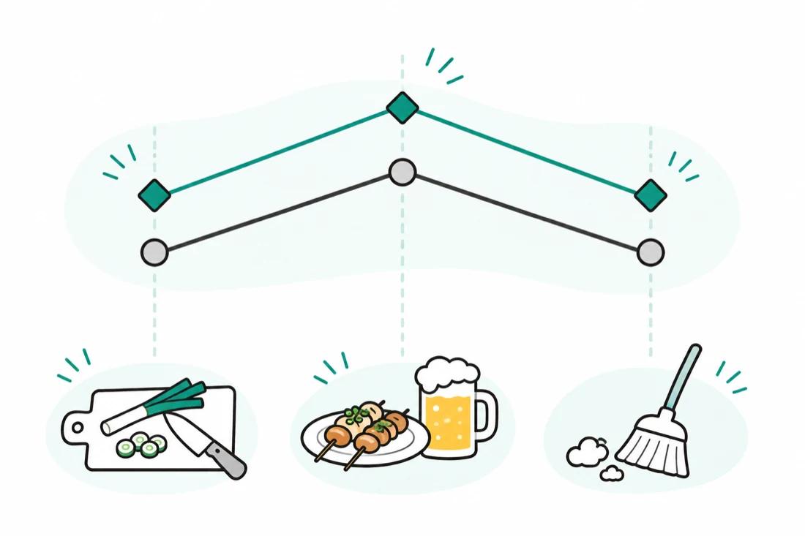

# 居酒屋のシフト表の作り方

金曜に宴会が入ると、乾杯のドリンクと通常の注文が重なり、ホールが回らなくなります。  
22時を過ぎて終電のある人が上がると、会計と洗い物を任せられる人が残りません。

居酒屋のシフト作りでつまずく場面は、だいたい4つです。  
希望が集まらない、何時まで入れるか分からない、金土と宴会だけ人が足りない、確定後の変更が伝わらない。  
どれも、希望を時刻つきで1か所に集め、時間帯ごとの必要人数を先に決めておくと軽くなります。

場面ごとに、店でできる対処と、[シフトリ](https://shiftori.app)を使ったときに店長の手間がどう変わるかを紹介します。

---

## 希望がバラバラに届いて締切までに集まらない

LINEの個別トーク、出勤したときの口頭、締切を過ぎてからの連絡。  
学生や掛け持ちのスタッフが多い店ほど、希望の届き方はばらけます。  
営業を終えてからトークをさかのぼって表へ書き写し、まだの人を名簿で探す。  
これが毎月続きます。

最初に決めるのは、提出先を1つにすることです。  
締切と催促する日も、募集のときに一緒に伝えておきます。  
LINEで集める場合の依頼文は、[LINEでシフト提出を受ける方法](/articles/line-shift-submission)に見本があります。

シフトリでは、募集を作るとスタッフ一人ひとりのLINEかメールに提出リンクが届きます。  
スタッフはアプリも会員登録もなしに、そのリンクから提出します。  
届いた希望はシフト表に並ぶので、書き写す作業はなくなります。  
まだ出していない人は画面で分かり、提出期限の前日17時には、その人たちにだけ催促が届きます（17時より前に作った募集が対象）。  
流れは[希望シフトの回収](/features/shift-request-collection)と[提出状況の確認と自動催促](/features/submission-reminder)で紹介しています。

---

## 何時まで入れるかが分からずラストを任せられない

「金曜、入れます」。  
この一言だけでは、締めまで任せられるかが分かりません。  
終電のある人も、翌朝に予定がある人も、ピークには入れます。  
残れないのは、ラストオーダーのあとです。  
結局、店長が一人ずつ「何時まで？」と聞き直すことになります。

希望は、開始と終了の時刻をセットで出してもらいましょう。  
「金曜は18〜22時」と届けば、締めに入れるかはその場で分かります。  
終電のある人には、着替えと駅までの移動を見込んで、店を出たい時刻を書いてもらいます。

シフトリの提出方法を「時間指定」にすると、スタッフは日付ごとに開始と終了の時刻を選んで提出します。  
閉店が24時を過ぎる店でも、「翌1時まで」のように日をまたぐ時刻を選べます。  
「終電が23時10分です」といった事情は、その日の連絡事項として希望に添えられます。

---

## 金土と宴会の日だけ人が足りなくなる

平日と同じ人数で金土を組むと、ピークで手が足りなくなります。  
宴会の日はもっと早く、開始前の席の準備と乾杯のドリンクに人を取られます。  
数えるのは1日の人数ではなく、時間帯ごとの人数です。

下の表は、スタッフ8人の店の例です。  
17時に開店して23時半に閉店し、締め作業は24時に終わります。  
ドリンクはホール、洗い場はキッチンの人数に含めています。

| 時間帯 | 平日 | 金土 | 宴会の予約あり |
| --- | --- | --- | --- |
| 仕込みと開店（15〜18時） | ホール1人、キッチン1人 | ホール1人、キッチン2人 | ホール2人、キッチン2人 |
| ピーク（18〜22時） | ホール2人、キッチン2人 | ホール3人、キッチン2人 | ホール4人、キッチン3人 |
| ラストと締め（22〜24時） | ホール1人、キッチン1人 | ホール2人、キッチン1人 | ホール2人、キッチン2人 |

表ができたら、入れる人が少ない枠から埋めていきます。  
最初はラストと締めです。  
レジ締めができるホールと、厨房を締められるキッチンを先に押さえます。  
次に、コースの進行やドリンク作りなど、経験のある人に任せたい枠を埋めます。  
新人は教えられる人と同じ時間帯に置き、残りの枠に希望を当てます。

シフトリでは、提出された希望が時刻つきでシフト表に並んだ状態から組み始めます。  
PCでは勤務時間が横棒で並ぶので、ピークと締めに誰が残るかを、必要人数表と見比べながら直せます。  
休み希望の日や希望した時間の外に勤務を入れると、確定の前に確認事項として表示されます。  
人数が足りているかを判断するのは店長で、シフトを自動で組む機能はありません。  
画面は[シフト表の作成](/features/shift-schedule)で見られます。

---

## 確定後に宴会の予約が入って変更の連絡が漏れる

シフトを確定したあとに、宴会の予約が入ることがあります。  
延長できる人に声をかけ、本人に個別で連絡し、グループには直した表を送り直す。  
その途中で一人に伝え忘れると、当日の「聞いていません」につながります。

予約が入ったら、必要人数表の「宴会の予約あり」の列と見比べて、足りない時間帯を確かめます。  
声をかけるのは、まずその日に出勤する人で延長できる人、次に休み希望を出していない人です。  
どちらも、本人が入れることを確かめてから勤務を変えます。

シフトリでは、確定するとスタッフ一人ひとりに、本人の勤務日と時間がLINEかメールで届きます。  
変更したときは、シフト表を書き換えて「変更があるスタッフに通知」を押します。  
届くのは勤務が変わった人にだけなので、誰に伝え直すかを洗い出す必要はありません。  
詳しくは[確定シフトの共有](/features/shift-sharing)で紹介しています。

---

## 次の募集で試すこと

次の募集の前に、店の必要人数表を1枚作ってみてください。  
行は仕込みと開店、ピーク、ラストと締めの3つ、列は平日、金土、宴会の日の3つです。  
希望を時刻つきで集めれば、金曜の22時以降にあと何人要るか、誰に声をかけるかが表から読めます。

集める手間と伝える手間も減らしたいときは、次の募集を[シフトリ](https://shiftori.app)で作ってみてください。
